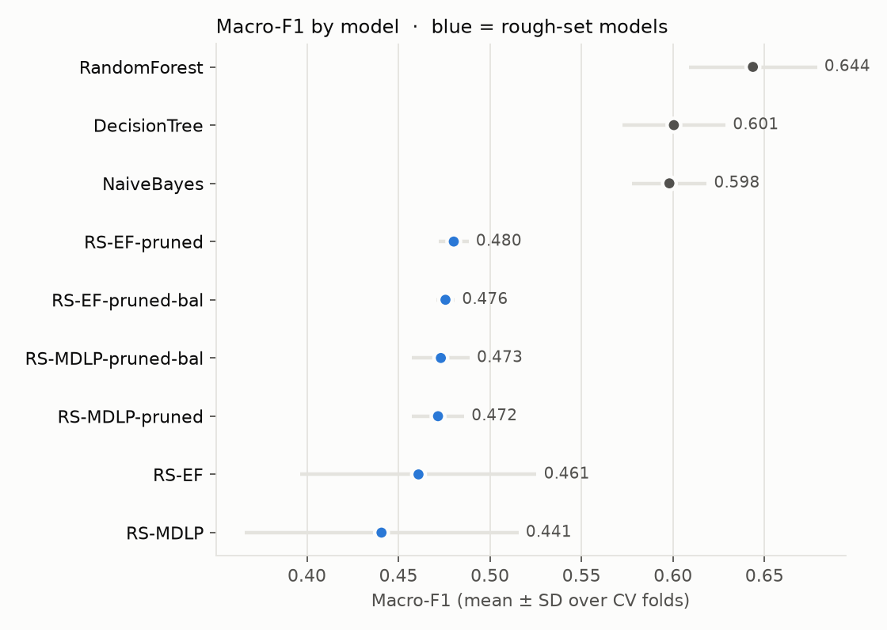
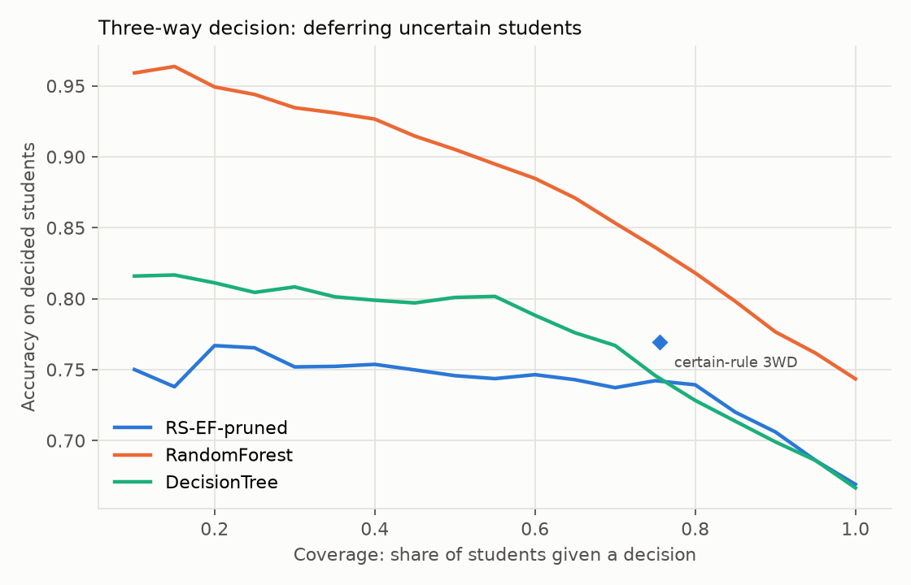

# Rough-Set Decision Rules for Early Prediction of Student Dropout

**Md Pares Mahmud · Abu Hanif · Shirsha Mitra**
Sichuan University · Information Granular Computing course project

 

## Overview

**Problem.** Can we warn early, right after the first semester, which students are likely to drop out, and explain the warning with short IF–THEN rules that an advisor can check by hand?

**Data.** UCI *Predict Students' Dropout and Academic Success* (Realinho et al., 2021/2022): 4,424 students, three outcomes (Graduate 2,209 · Dropout 1,421 · Enrolled 794). Only enrollment attributes and 1st-semester results are used (30 condition attributes). All 2nd-semester columns are dropped.

**Method.** A rough-set pipeline, fit inside every CV training fold:

1. Discretization: Equal-Frequency (k = 4) or entropy-based MDLP
2. Reduct: QuickReduct with a **granule-size-aware dependency** (minimum granule size *s*, VPRS precision β, tuned per fold)
3. Rules: LEM2 certain and possible rules, pruned by support ≥ 5 and confidence ≥ 0.6
4. Classification: LERS voting, plus a **three-way decision** (accept / defer) for uncertain students

Baselines: Decision Tree, Random Forest, Naive Bayes.

## Final project

The final study uses five repeats of stratified ten-fold cross-validation.
Its primary analysis excludes debtor, tuition, and scholarship status because
field-level availability at the semester-one cutoff could not be verified.
The full feature set is included as a sensitivity analysis.

In the primary analysis, class-aware equal-frequency rules raised mean recall
for the Enrolled class from 0.1% to 30.4% and macro-F1 from 0.466 to 0.574.
Random Forest achieved the highest mean macro-F1 at 0.614.

The class-aware extension compares rules and granules against each outcome's
training prevalence. It gives each class equal weight when selecting the reduct
and uses class-normalized LERS voting. A stratified inner training split tunes
granule size, required precision, and pruning. Both EF and MDLP use the same
outer splits as the fixed-pruning and classical comparisons.

- [Final report (PDF)](final/final_report.pdf)
- [Saved results and interpretation tables](results/full/summary.md)

The black-and-white report includes a team-roles table based on the
milestone's documented contributions and final-phase assignments.

The submission archive includes the public UCI CSV, the analysis code, and
the completed CSV and JSON outputs. The dataset is by Valentim Realinho,
Mónica Vieira Martins, Jorge Machado, and Luís M. T. Baptista.
It is distributed under [CC BY 4.0](https://creativecommons.org/licenses/by/4.0/).
The archived CSV preserves the source bytes.
[UCI dataset and citation](https://doi.org/10.24432/C5MC89)

The measured run used Python 3.13.9 and the versions in
[`final/requirements-reproduce.txt`](final/requirements-reproduce.txt).
From this folder, reproduce the figures, tables, and held-out case walkthrough:

```powershell
python -m pip install -r final/requirements-reproduce.txt
$env:OPENBLAS_NUM_THREADS = "1"
$env:OMP_NUM_THREADS = "1"
python -m pytest
python run_all.py data/data.csv
python -m rsproject.ablation
python -m rsproject.learning_curve
python -m rsproject.case_study
```

The final run writes paired test-fold metrics, confusion matrices, finance and
discretization sensitivity results, rule examples, and selective-decision tables
to `results/full`. The full-data rule files are for interpretation. Model
performance comes from the held-out folds. The run also recreates the local
prediction caches used by the figure and table builder.

With the saved tables and the dataset in place, install `reportlab==5.1.0`
to regenerate the submission files via `python -m final.report` and
`python -m final.presentation`.

## Milestone results (1×10 stratified CV)

| Model | Accuracy | Macro-F1 | MCC | Recall Enrolled | Rules |
|---|---|---|---|---|---|
| RS-EF-classic (exact Pawlak reduct)* | .635 | .524 | .379 | .164 | 1,337 |
| **RS-EF-pruned** (ours) | **.669** | .480 | .448 | .000 | 8.2 |
| **RS-MDLP-pruned** (ours) | .660 | .472 | .431 | .000 | 8.2 |
| Decision Tree | .667 | .601 | .459 | .343 | – |
| Random Forest | .743 | .644 | .572 | .252 | – |
| Naive Bayes | .691 | .598 | .485 | .234 | – |

<sub>*Not part of `--quick`; run separately on the same 10 folds. Rules = mean number of rules per fold.</sub>

**Main findings**

- The granule-size-aware reduct cuts the rule set from about 1,337 rules to about 8, and accuracy is on par with the Decision Tree (.669 vs .667).
- The pruned rough-set models never predict **Enrolled**. Its rules are too weak to survive pruning, which is why macro-F1 is 0.12–0.17 below the baselines. This gap is statistically significant (Wilcoxon + Holm, corrected t-test). Fixing it is the next step.
- The certain-rule three-way decision decides for 75.6 % of students at 76.9 % accuracy, against 66.9 % when it must decide for everyone.

<p>
  
  
</p>

**Example rules** (MDLP, fit on all data for interpretation; grades on the 0–20 scale)

| Rule | Students | Confidence |
|---|---|---|
| IF tuition fees up to date AND 1st-sem grade ≥ 13.29 → **Graduate** | 1,156 | 0.80 |
| IF 1st-sem grade < 9.9 → **Dropout** | 719 | 0.79 |
| IF tuition fees NOT up to date → **Dropout** | 528 | 0.87 |

The milestone report is in [docs/milestone_report.pdf](docs/milestone_report.pdf).

---

## 1. Setup in VS Code (do this once)

1. Install **Python 3.10+** and **VS Code** with the **Python** extension (Microsoft).
2. Open this folder in VS Code: *File → Open Folder… → `gc_project`*.
3. Open a terminal (*Terminal → New Terminal*) and create a virtual environment:

   **Windows (PowerShell)**
   ```powershell
   python -m venv .venv
   .venv\Scripts\Activate.ps1
   pip install -r requirements.txt
   ```
   **macOS / Linux**
   ```bash
   python3 -m venv .venv
   source .venv/bin/activate
   pip install -r requirements.txt
   ```
   If PowerShell blocks activation, run `Set-ExecutionPolicy -Scope CurrentUser RemoteSigned` once.
   On Windows, VS Code may ask you to pick the interpreter: choose `.venv\Scripts\python.exe` (Ctrl+Shift+P → *Python: Select Interpreter*).

4. Put the dataset in place: download it from https://archive.ics.uci.edu/dataset/697, unzip, and copy **`data.csv`** to `data/data.csv`.

5. Check everything works:
   ```bash
   python -m pytest                       # rough-set unit tests
   python run_all.py --synthetic --quick   # pipeline test on fake data
   ```

## 2. Running the project

| Goal | Command |
|---|---|
| Milestone results | `python run_all.py data/data.csv --quick` |
| Final results | `python run_all.py data/data.csv` |
| Redo tables and figures | `python -m rsproject.report results/full` |

You can also press **F5** in VS Code and pick a configuration from `.vscode/launch.json`.

Outputs, in `results/quick/` or `results/full/`:

- `summary.md`: every result table in one file (open it in VS Code and press Ctrl+Shift+V to preview)
- `tables/*.csv`: metrics, rule quality, significance tests, three-way decision tables
- `figures/*.png`: model comparison, coverage-accuracy curve, pruning, reduct stability
- `final_rules_MDLP.csv`, `final_rules_EF.csv`: the readable IF–THEN rules (fit on all data, used for interpretation only)
- `fold_results.csv`: raw per-fold numbers

## 3. What the code does

```
rsproject/
  data.py         load data.csv, rename columns, early-warning filter
  discretize.py   Equal-Frequency, MDLP (entropy, Fayyad-Irani), rare-category grouping
  roughsets.py    granules, approximations, dependency, QuickReduct, LEM2,
                  pruning, LERS classification, three-way decisions
  experiment.py   repeated stratified 10-fold CV, baselines, everything saved
  report.py       tables, Wilcoxon + Holm, corrected t-test, figures
  synthetic.py    fake data with the same columns (testing only)
run_all.py        one command for everything
tests/            hand-checkable tests on a 5-row decision table
```

Pipeline (inside each training fold, so nothing leaks into the test fold):

1. **Discretize**: Equal-Frequency (k=4) **or** MDLP entropy-based. Category codes that cover less than 2% of students are merged into "other".
2. **Reduct**: QuickReduct, greedy on the dependency degree γ.
3. **Rules**: LEM2 on the lower approximation of each class (certain rules) and the upper approximation (possible rules).
4. **Prune**: keep rules with support ≥ 5 and confidence ≥ 0.6. These values were fixed before the experiment; a sensitivity grid is also reported.
5. **Classify**: LERS voting (strength × specificity), with partial matching when no rule fits completely.
6. **Three-way decision**: accept when only certain rules of one class match, defer otherwise. There is also a threshold version (coverage–accuracy curve) and a Dropout accept/defer/reject view.

Models compared: `RS-EF-classic` (standard Pawlak pipeline), `RS-EF` / `RS-MDLP` (unpruned), `RS-*-pruned`, `RS-*-pruned-bal` (class-normalized voting), Decision Tree, Random Forest, Naive Bayes.

## 4. Changes from the proposal (say these in the milestone/report)

- **Python instead of the R package RoughSets.** RoughSets has no entropy-based discretization (it offers quantile, equal-interval and discernibility methods only), so we implemented the pipeline ourselves. The algorithms are the same ones the proposal names: reducts, LEM2, LERS.
- **Granule-size-aware dependency for the reduct.** With classical γ, QuickReduct selects many-valued attributes (for example parents' occupation) because tiny granules are trivially "consistent". This overfits badly: hundreds or thousands of rules. We count a granule toward the positive region only if it holds at least *s* students, and use a VPRS-style precision β (Ziarko, 1993). *s* and β are chosen inside each training fold on a 25% inner holdout. This is a granular computing contribution in its own right: **choosing the right granule size**.
- **Leakage check.** The measurement time of `Debtor`, `Tuition fees up to date` and `Scholarship holder` is not documented, so every model is also run without them (`feature_set = no_finance`).
- **Statistics.** We use 5×10 repeated CV with the Wilcoxon signed-rank test and Holm correction, plus the Nadeau–Bengio corrected resampled t-test, because CV folds are not independent.
- **Fair three-way comparison.** Baselines can also abstain (via predicted-probability thresholds), so selective accuracy is compared at equal coverage.

## 5. Extra references used by the code

- Fayyad, U. M., & Irani, K. B. (1993). Multi-interval discretization of continuous-valued attributes for classification learning. *IJCAI-93*, 1022–1029.
- Ziarko, W. (1993). Variable precision rough set model. *Journal of Computer and System Sciences*, 46(1), 39–59.
- Chouchoulas, A., & Shen, Q. (2001). Rough set-aided keyword reduction for text categorization. *Applied Artificial Intelligence*, 15(9), 843–873. (QuickReduct)
- Nadeau, C., & Bengio, Y. (2003). Inference for the generalization error. *Machine Learning*, 52(3), 239–281.
